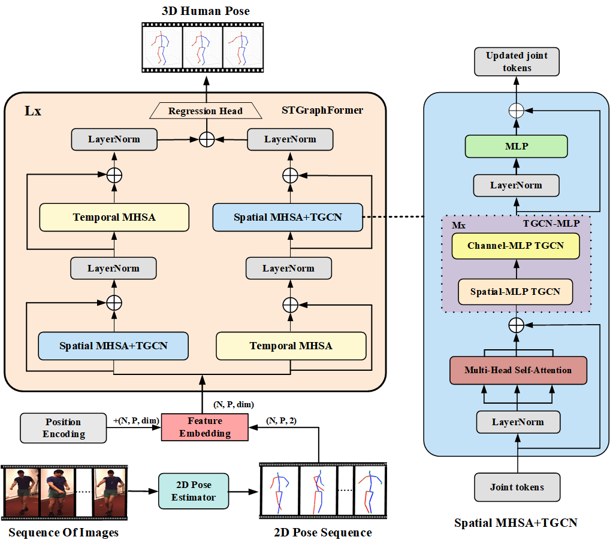
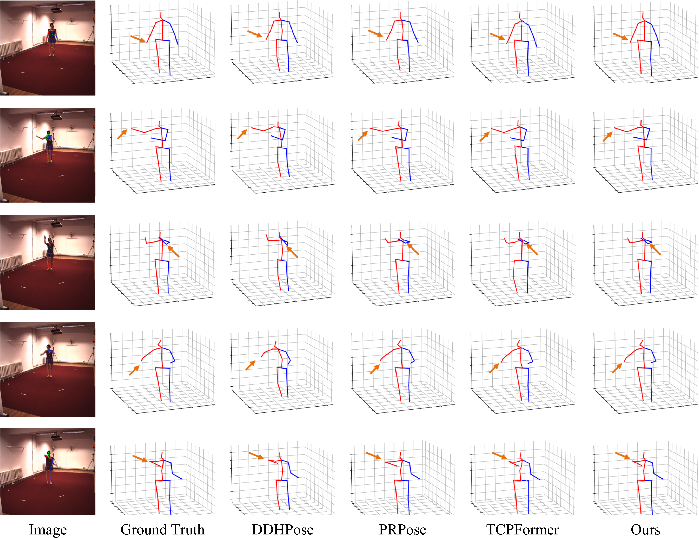

# MGCNTrans: Multi-Frame Lifting for 3D Human Pose Estimation

This repository provides a PyTorch implementation of **MGCNTrans**, a multi-frame lifting framework for 3D human pose estimation from monocular videos. MGCNTrans integrates temporal self-attention with spatial graph convolutions to effectively capture motion dynamics and human joint relationships. The codebase supports full pipelines for model training, evaluation, and visualization on the Human3.6M and MPI-INF-3DHP benchmarks.

---

## Framework Overview



The overall architecture of MGCNTrans is illustrated above. Given an input image sequence, a 2D pose detector first extracts a corresponding sequence of 2D poses. These poses, augmented with feature embeddings and positional encodings, are formulated as joint tokens and subsequently processed by a cascade of STGraphFormer blocks. Each block comprises two complementary branches: a temporal multi-head self-attention (MHSA) module that captures long-range temporal dependencies, and a spatial MHSA+TGCN branch that models inter-joint spatial relationships. Within the spatial pathway, a TGCN-MLP module further refines the joint representations via spatial and channel-wise graph convolutions. Finally, a regression head maps the refined representations to a 3D human pose sequence, yielding coherent and structurally consistent estimates.

---

## Qualitative Comparison



Qualitative comparison on the **Directions** action from the Human3.6M dataset. From left to right, the columns show the input image, ground truth, DDHPose, PRPose, TCPFormer, and MGCNTrans (Ours). The orange arrows highlight differences in the estimated joint positions. MGCNTrans produces more accurate upper-limb poses and better preserves bone-length consistency and natural motion patterns, resulting in more faithful and structurally coherent 3D pose estimates.

---

## Installation

The codebase is developed and tested with the following dependencies:

- Python 3.7.0  
- PyTorch 1.8.1  
- NumPy 1.21.5  
- OpenCV-Python 4.5.5.64  
- Mayavi 4.7.4  
- MATLAB 2020a  

---

## Dataset Setup

### Human3.6M

Please download the original dataset from the [Human3.6M](http://vision.imar.ro/human3.6m/) website. For data preprocessing and directory structuring, please refer to the instructions provided in [VideoPose3D](https://github.com/facebookresearch/VideoPose3D). Alternatively, pre-processed data can be downloaded directly from [this Google Drive link](https://drive.google.com/drive/folders/1E82Kwtjjvh4pnaCShsymI06pqJ76Hqru) and placed in the `./data` directory.

### MPI-INF-3DHP

We preprocess the MPI-INF-3DHP dataset from its original `.mat` format into `.npz` files using the provided scripts `data_to_npz_3dhp.py` and `data_to_npz_3dhp_test.py`. The processed data is also available for download from [this Google Drive link](https://drive.google.com/drive/folders/1E82Kwtjjvh4pnaCShsymI06pqJ76Hqru) and should be placed in the `./data` directory.

To compute PCK and AUC metrics on this dataset, you additionally need to download the original dataset from the [official MPI-INF-3DHP website](https://vcai.mpi-inf.mpg.de/3dhp-dataset/). After downloading, place the test set folders (`TS1` to `TS6`) under the `./3dhp_test` directory in this repository.

The expected directory structure is as follows:

```bash
${MGCNTrans}/
|-- data
|   |-- data_3d_h36m.npz
|   |-- data_2d_h36m_gt.npz
|   |-- data_2d_h36m_cpn_ft_h36m_dbb.npz
|   |-- data_test_3dhp.npz
|   |-- data_train_3dhp.npz
```

---

## Training and Evaluation

### Human3.6M

To train MGCNTrans from scratch on Human3.6M, run the following command with the recommended hyperparameters:

```bash
python run_mgcntrans_h36m.py --batch_size 256 --num_workers 2 --epochs 60 --keypoints gt --hid_dim 256 --intermediate --pred_dropout 0.2 --augment
```

### MPI-INF-3DHP

To train MGCNTrans from scratch on MPI-INF-3DHP, use:

```bash
python run_mgcntrans_3dhp.py --batch_size 256 --num_workers 2 --epochs 60 --keypoints gt --hid_dim 256 --intermediate --pred_dropout 0.2 --augment
```

To evaluate a trained model, append the `--evaluate {path/to/checkpoint}` flag to the corresponding training command.

After evaluation on MPI-INF-3DHP, an `inference_data.mat` file will be generated in the `results` folder. This file can be used to compute AUC and PCK metrics via the `mpii_test_predictions_py.m` script located in `3dhp_test/test_util`. The resulting evaluation report will be saved as `mpii_3dhp_evaluation_activitywise.csv` in the `3dhp_test` directory.

---

## Visualization

To visualize model predictions, use the `demo/vis.py` script with the `--pre` argument set to the path of your trained checkpoint.

Before running the visualization, download the pretrained YOLOv3 and HRNet models from [this Google Drive link](https://drive.google.com/drive/folders/1twGLYjw0pbSbFjGYw22p5De0qygZ0yc0?usp=sharing) and place them in the `./demo/lib/checkpoint` directory.

Place your input videos in the `./demo/video` folder. The visualization results will be saved under `./demo/demo`.

---

## Acknowledgements

Our codebase is built upon the following open-source repositories. We sincerely thank the respective authors for making their work publicly available:

- [JointFormer](https://github.com/seblutz/JointFormer)  
- [GraphMLP](https://github.com/vegetebird/graphmlp)  
- [VideoPose3D](https://github.com/facebookresearch/VideoPose3D)  
- [P-STMO](https://github.com/patrick-swk/p-stmo)  
- [SemGCN](https://github.com/garyzhao/SemGCN)